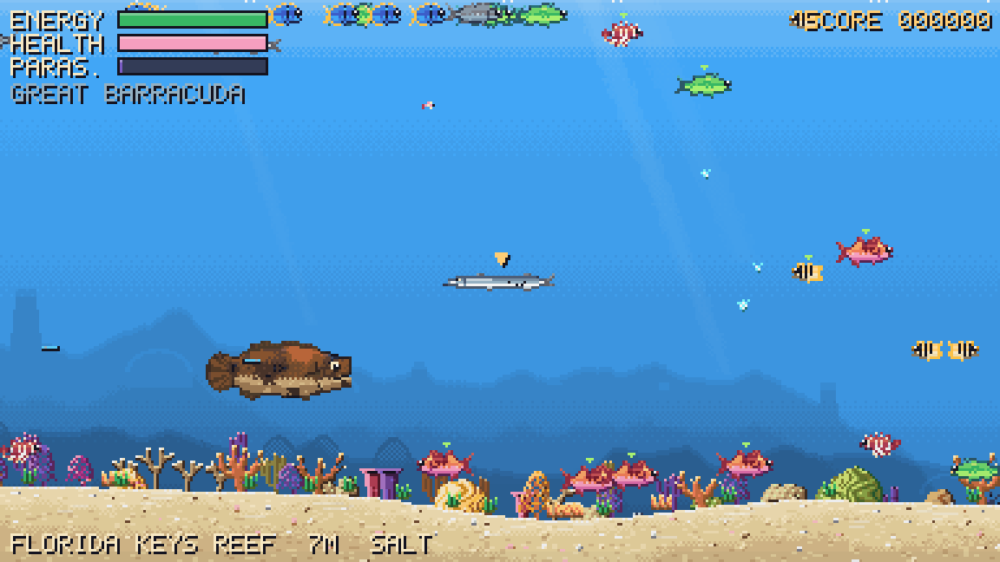
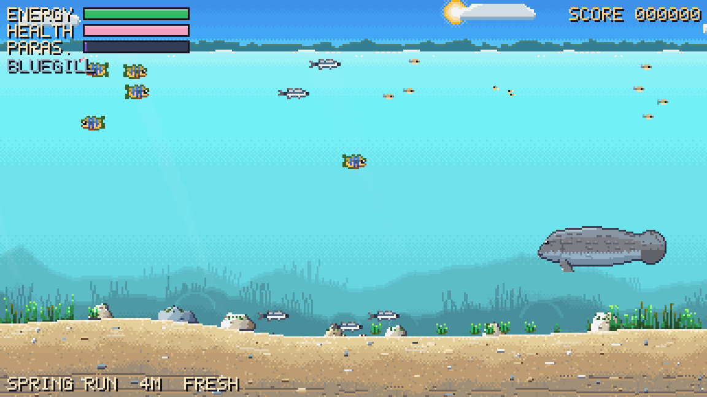
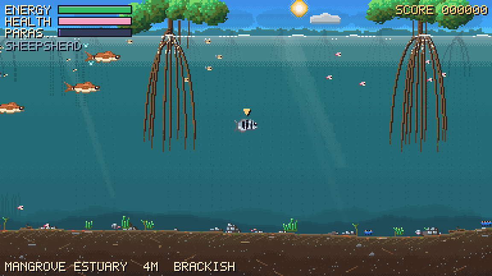
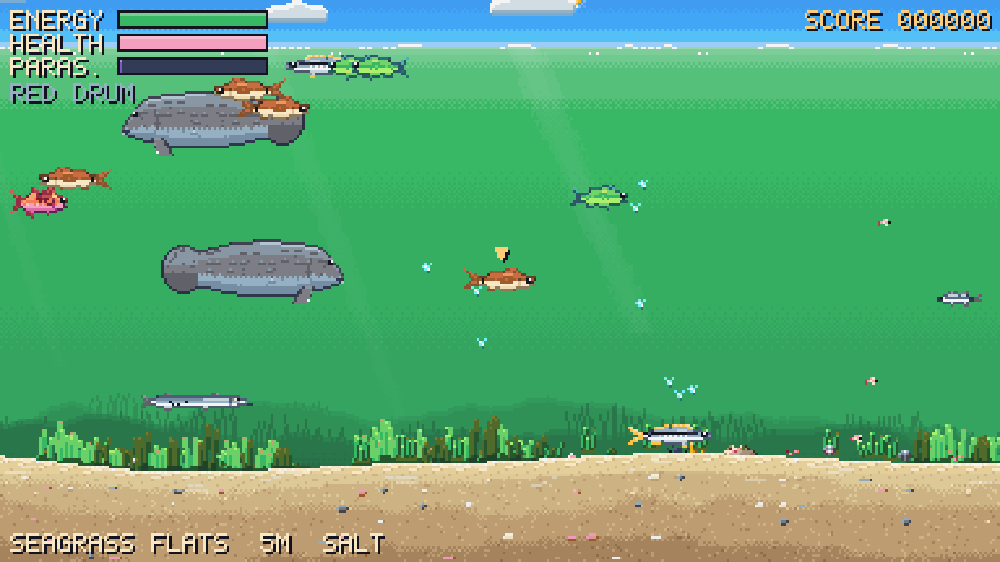
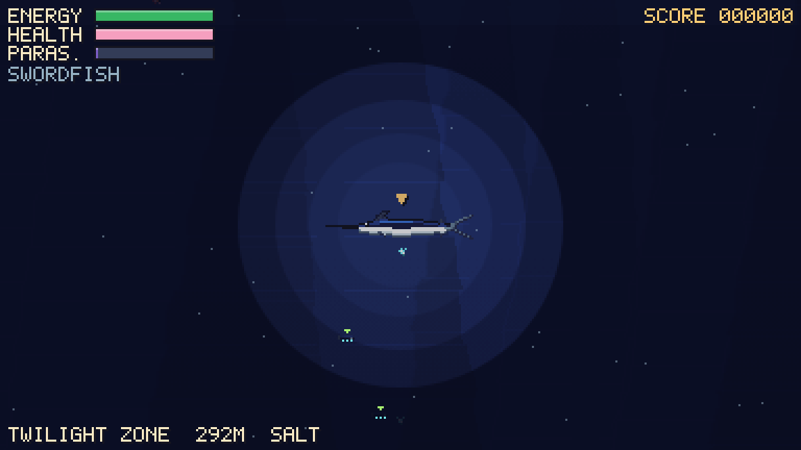

<div align="center">

# Down Under Again

**A retro pixel-art survival game about life in Florida's waters, from freshwater spring to deep sea.**

[**▶ Play in your browser**](https://michaelaperry.github.io/DownUnderAgain/)

[](https://github.com/MichaelAPerry/DownUnderAgain/actions/workflows/pages.yml)




</div>

## About

Down Under Again is a fan-made spiritual successor to *Odell Down Under* (MECC,
1994), the classic educational game in which you play a fish trying to eat,
stay clean and not get eaten.

This version moves the action to Florida and makes the ecosystem live. Every
creature on screen is simulated: predators hunt, prey school and hide,
cleaner gobies run their stations, and invasive lionfish spread if nothing
eats them. Swim the whole transect as one continuous world:

```
Spring Run ─► Mangrove Estuary ─► Seagrass Flats ─► Florida Keys Reef ─► Gulf Stream Drop-off
  fresh          brackish              salt                                       │
                                                                                  ▼
                                                                    Twilight Zone (150 m+)
```

| | |
|:---:|:---:|
|  |  |
| **Spring Run.** Clear aquifer water, eelgrass and bass | **Mangrove Estuary.** Brackish nursery among the roots |
|  |  |
| **Seagrass Flats.** Turtle-grass meadows over white sand | **Twilight Zone.** Darkness, marine snow and bioluminescence |

## Features

- **21 playable species** from the Florida Keys and inland waters, from the 6 cm eastern mosquitofish to the great hammerhead, plus manatees and a dozen kinds of plants, plankton and invertebrates.
- **A living food web.** Who eats whom follows from each animal's diet and jaw size. Green markers show what you can eat; a red **!** means a predator has spotted you.
- **Real ecology to work with:**
  - **Salinity.** Freshwater fish suffer in the sea. Bull sharks and snook cross freely.
  - **Depth.** Each species has a comfortable range, and the deep is dark.
  - **Cover.** Small fish hide in seagrass, mangrove roots and reef crevices.
  - **Parasites.** Visit a cleaner goby, or rub on the sand to scrape them off.
  - **Invasive lionfish.** Venomous, spreading, and worth double points.
- **Four modes:**
  - **Free Swim**: pick any fish and survive.
  - **Evolution**: eat to earn Biomass, then mutate mid-run with Power Fins, Big Jaw, Camouflage, Spike Spines and more.
  - **Tournament**: climb the whole food chain, from mosquitofish to hammerhead, with three lives.
  - **Challenge**: four random fish of growing size, one life.
- **Custom Fish Sandbox.** Spend 20 points on size, speed, senses, jaw, camouflage, spines, armor and efficiency, then choose a diet, home waters, body shape, pattern and colours. The pixel art is generated from your design.
- **Reef Codex.** A field guide that fills in as you meet each creature, with its diet, predators, conservation status and a fact.
- **Authentic low-res look.** The game draws to a 384×216 canvas, scaled up crisply, with a fixed retro palette and chiptune sound effects. All art and sound is generated in code; there are no image or audio files.

## How to play

| Key | Action |
|---|---|
| **WASD** / **Arrow keys** | Swim |
| **Hold left mouse button** | Swim toward the cursor |
| **Shift** / **Space** | Burst of speed (burns extra energy) |
| **Esc** / **P** | Pause |
| **Tab** | Evolve (Evolution mode) |
| **C** | Toggle food-web cues |
| **M** | Mute |

**Tips**
- Bite mouth-first. Approaching from behind a predator is safe.
- Keep an eye on the bottom-left readout: zone, depth and salinity.
- When the parasite meter climbs, find a cleaner goby on the reef or rest on the sand.
- Small and hungry? Stay near cover until you're bigger.

The game runs in any modern desktop browser. Progress (Codex discoveries, best scores, your custom fish) is saved locally in the browser.

## Development

Requires Node.js 22 or newer.

```bash
npm install
npm run dev          # local dev server at http://localhost:5173
npm run check        # strict typecheck + unit tests
npm run e2e          # Playwright browser smoke tests
npm run build        # production build into dist/
```

Art tools:

```bash
npm run sprites      # render every creature sprite to docs/art/sprites.png
npm run screenshots  # capture each zone to docs/screenshots/ (needs `npm run dev -- --port 5181`)
```

The game is written in TypeScript (strict) with Vite, Canvas 2D and Tailwind CSS,
and uses no runtime framework. The simulation is deterministic and runs headless
under Vitest. [docs/ARCHITECTURE.md](docs/ARCHITECTURE.md) covers the module
layout, game-state machine, AI and food-web design.

**Deployment.** `.github/workflows/pages.yml` typechecks, tests and builds every
pull request and deploys `main` to GitHub Pages. To deploy a fork, set
*Settings → Pages → Source* to **GitHub Actions**.

## Contributing

Issues and pull requests are welcome, especially corrections to species facts,
new regions (the data model supports more than Florida) and art. Please run
`npm run check` and `npm run e2e` before opening a pull request.

## Credits

- Inspired by *Odell Down Under* (MECC, 1994). This is an independent fan project, not affiliated with MECC, SoftKey or the original rights holders.
- Species information is summarised from general reference sources for educational use. If you spot an error, please open an issue.
- Built with the help of [Claude Code](https://claude.com/claude-code).
- Font: [Press Start 2P](https://fonts.google.com/specimen/Press+Start+2P) by CodeMan38 (SIL Open Font License 1.1), bundled via Fontsource.

## License

[MIT](LICENSE) © 2026 Michael Perry
